<div align="center">
  <picture>
    <source media="(prefers-color-scheme: dark)" srcset="assets/banner-dark.png" />
    
  </picture>
  <h1>collet</h1>
  <p><strong>Keep a coding session inside one task, its files and the command that finishes it.</strong></p>
</div>

<p align="center"><strong>Available on</strong></p>
<table align="center">
  <tr>
    <td align="center"><a href="#claude-code"><br />Claude Code, primary host</a></td>
    <td align="center"><a href="#codex"><br />Codex</a></td>
    <td align="center"><a href="#antigravity"><br />Antigravity</a></td>
  </tr>
</table>

<p align="center"><a href="#install"><strong>Get started</strong></a> · <a href="#what-is-this">What is this?</a> · <a href="#how-it-works">How it works</a> · <a href="#what-you-can-do">What you can do</a> · <a href="#the-numbers">Evidence</a></p>

## What is this?

You ask for a fix in the cart module. The session also edits two unmentioned files, then says it is done without running the tests. This example is illustrative, not a recorded run.

collet ties a session to one open task. The task names its writable files and the command that must pass before it closes. A change outside those files makes closing fail. If the project asks, hooks refuse such a write as it happens. collet does not plan the work.

<p align="center"></p>

Open a task for the cart file, then close it:

```shell
node .collet/task.mjs add --title "Round the cart total" --why "Prices show three decimals" --scope "src/cart.mjs"
node .collet/task.mjs close --left-out "currency formatting" --unverified "nobody ran this against real prices"
```

`add` prints the open task, its scope and the accept command. `close` fails while a change sits outside `src/cart.mjs`, or while the accept command exits non-zero.

## Why you'd want it

- **Every session knows its task.** It starts knowing its files and how the task ends.
- **Drift is named.** The task cannot close while a change outside its files stands.
- **Finished means a command exited zero.** A summary saying so does not count.
- **Recurring mistakes get a check.** Add one when a mistake keeps happening.

## How it works

Mounting creates `.collet/` and adds a rules block to `AGENTS.md`.

| Step | What collet does |
| --- | --- |
| Write | A guard reads the write. Outside the task, it notes the path, or refuses when `refuse_out_of_scope_writes` is `true`. |
| Close | `node .collet/task.mjs close` checks the working tree against the task, then runs the accept command. A failure of either leaves the task open. |
| Check | Every check ships with a planted mistake and a near miss. A failed pair never counts as coverage. |

[How collet works](docs/knowledge/how-it-works.md) covers the guard, imports, private records and the Foreman link.

## What you can do

| You want to | Command or request |
| --- | --- |
| Mount the harness | `/collet:task-harness` on Claude Code, `$task-harness` on Codex, `/task-harness` on Antigravity |
| Inspect the task | `node .collet/task.mjs status` |
| List every task | `node .collet/task.mjs list` |
| Open a task | `node .collet/task.mjs add --title "..." --why "..." --scope "src/cart.mjs,test/**"` |
| Add a file the open task needs | `node .collet/task.mjs widen --add <path> --why "<reason>"` |
| Close the task | `node .collet/task.mjs close --left-out "..." --unverified "..."` |
| Prove the checks still catch what they claim | `node .collet/checks/run.mjs` |
| Check the working tree against the open task | `node .collet/checks/run.mjs --live` |
| Add a check for a recurring mistake | `/collet:check-writer help me catch skipped tests` on Claude Code; `$check-writer` on Codex; `/check-writer` on Antigravity |

### Settings

Values live in `.collet/config.json`. After mounting, fill in the two required ones: a task cannot open while either is a placeholder.

| Name | What it does |
| --- | --- |
| `project` | Required. One line on what the repository is and what it runs on. |
| `accept` | Required. The command a task closes with, unless the task names its own. |
| `refuse_out_of_scope_writes` | Set by hand to `true`. The guard refuses a write outside the open task instead of noting it. |

Create `.collet/off` to silence every session guard. Committed checks keep running.

[Collet settings](docs/knowledge/settings.md) lists all seven.

## Install

collet is one package for three hosts. Every host needs Node.js 22 or later and Git. Your project needs a Git repository with a committed baseline, because scope checks use `git diff` and `git ls-files`.

### Claude Code

Requirements: Claude Code 2.1.323 or later. Inside Claude Code, run:

```text
/plugin marketplace add V-Songbird/foundry
/plugin install collet@foundry
```

Start a new session. In a terminal, `claude plugin list` names `collet` once it is installed.

### Codex

Requirements: a Codex host with plugin support.

```text
codex plugin marketplace add V-Songbird/foundry
codex plugin add collet@foundry
```

Open `/hooks` in Codex CLI and trust the plugin's `SessionStart`, `PreToolUse` and `PreCompact` hooks. A changed hook definition or script needs another review; see [Codex hook trust](https://learn.chatgpt.com/docs/hooks#review-and-trust-hooks). Then start a new Codex session.

### Antigravity

Requirements: the Antigravity CLI. Antigravity has no marketplace for third-party plugins, so install from a clone of Foundry, which checks collet out at the pinned commit. Replace `<path-to-clone>` with the clone directory:

```shell
git clone --recurse-submodules https://github.com/V-Songbird/foundry.git <path-to-clone>
agy plugin install <path-to-clone>/collet
agy plugin list
```

The list names `collet`. If it does not, run the install command again with the clone path. Start a new conversation. Use CLI installation; workspace-directory discovery is unverified.

### Update

On Claude Code, then start a new session:

```text
/plugin marketplace update foundry
/plugin update collet@foundry
```

On Codex, then start a new session and trust any changed hook in `/hooks`:

```text
codex plugin marketplace upgrade
codex plugin add collet@foundry
```

An Antigravity install is a copy that keeps its installed commit. Update the clone, install again, then start a new conversation:

```shell
git -C <path-to-clone> pull
git -C <path-to-clone> submodule update --init
agy plugin install <path-to-clone>/collet
```

## Good to know

> **Experimental.** No support or stability promise. It can change or disappear without a migration path.

No open task means no enforcement. That is deliberate.

| Area | Limit |
| --- | --- |
| Timing | Without `refuse_out_of_scope_writes`, a write outside the task is caught at close, not as it happens. |
| Antigravity | Only the write guard runs there. Its refusal is checked by tests, not by a live session. |
| Shell writes | The guard recognizes specific forms. A path built from a variable goes through. |
| Optional checks | At write time they read only `Write`, `Edit` and `MultiEdit` text. Everything else waits for `close`. |
| JavaScript skips | Dynamic calls, quoted option keys and complex option objects are not covered. |
| Match counts | Replacing one match with another can leave the count unchanged. |
| Split files | The write-time check refuses matches moved into a new file, although closing accepts them. |
| Rules files | The guard refuses writes to a rules file the open task does not list. |
| Closing | A skipped check prevents closing. A mount below the Git root sees only its own directory. |
| Hook timeout | A host cuts a hook short at 10 seconds. Hook errors fail open. |
| Invisible text | `task.mjs` and `mount.mjs` refuse invisible characters and name the field. |
| Fixture score | It does not measure false alarms on your code. A green accept command does not mean the work is correct. |
| Live runs | Mounting and check writing are unverified in the Antigravity IDE. |
| Compaction | Automatic compaction on Claude Code, and compaction in an interactive Codex session, are unverified. |
| Evidence | Unit tests supply host-shaped events to the hooks. They do not prove live host integration. |

[Collet limits](docs/knowledge/limits.md) states each one in full.

## The numbers

The fixture score is not a session measurement. `node .collet/checks/run.mjs` catches 5 of 5 planted scope violations and leaves 6 of 6 near misses alone. It prints `ok   scope — 5 violation(s) caught, 6 near miss(es) left alone`.

### Claude Code results

<!-- foundry:evidence {"platform":"Claude","status":"measured","models":["Claude Opus 5.5"],"source":"docs/knowledge/benchmarks.md","date":"2026-11-16","revision":"a70b19e","reviewedAt":"2026-11-16"} -->
| Model | Case | Grader | With collet | Without |
| --- | --- | --- | --- | --- |
| Claude Opus 5.5 | `check-writer-admits-a-check` | `cart-unchanged` | 3/3 | 2/3 |
| Claude Opus 5.5 | `check-writer-admits-a-check` | `check-admitted` | 3/3 | 2/3 |
| Claude Opus 5.5 | `guard-refuses-out-of-scope-write` | `guard-refused` | 0/3 | not graded |
| Claude Opus 5.5 | `mount-opens-first-task` | `config-filled` | 3/3 | 0/3 |
| Claude Opus 5.5 | `mount-opens-first-task` | `first-task-open` | 3/3 | 0/3 |
| Claude Opus 5.5 | `mount-opens-first-task` | `harness-proven` | 3/3 | 0/3 |
| Claude Opus 5.5 | `mount-opens-first-task` | `rules-block-kept-map-text` | 3/3 | 0/3 |

<p align="center"></p>

The run was on 2026-11-16 at commit `a70b19e`. It had three cases, three runs per arm and 18 sessions. It used `claude-opus-5-5` through the Claude Agent SDK, not a Claude Code session. Judged graders ran on `claude-sonnet-5-5`. The table lists the graders where the arms differed.

**One result is a loss.** `guard-refused` passed 0 of 3 with collet. The sessions never tried the write. The start-of-session text told each that a file outside the task is refused, so each left `package.json` alone and named it. The guard's log existed in every run, so the hook ran, but no write reached it. Three runs per arm are exploratory.

[Collet benchmarks](docs/knowledge/benchmarks.md) holds the method and what the table leaves out.

### Codex results

<!-- foundry:evidence {"platform":"Codex","status":"pending","reason":"No Codex session measurement of collet exists."} -->
| Model | Setup | Tasks closed in scope |
| --- | --- | --- |
| Not measured | Not measured | Not measured |

No Codex session has been measured yet.

### Antigravity results

<!-- foundry:evidence {"platform":"Antigravity","status":"pending","reason":"No Antigravity session measurement of collet exists."} -->
| Model | Setup | Tasks closed in scope |
| --- | --- | --- |
| Not measured | Not measured | Not measured |

No Antigravity session has been measured yet.

## Going deeper

[How collet works](docs/knowledge/how-it-works.md) · [Collet settings](docs/knowledge/settings.md) · [Collet limits](docs/knowledge/limits.md) · [Collet benchmarks](docs/knowledge/benchmarks.md)

Release notes are on the [collet releases page](https://github.com/V-Songbird/collet/releases). Contributors start at [CONTRIBUTING.md](CONTRIBUTING.md).

## License

MIT, see [LICENSE](LICENSE).
