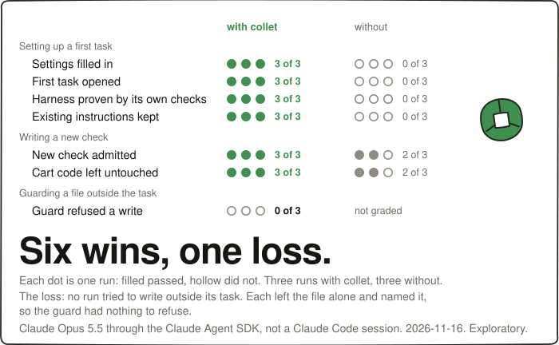

<div align="center">
  
  
  <h1>Collet</h1>
  <p><strong>Keep a coding session inside one task, its files and the command that finishes it.</strong></p>
</div>

<p align="center"><strong>Available on</strong></p>
<table align="center">
  <tr>
    <td align="center"><a href="#install"><br />Claude Code</a></td>
    <td align="center"><a href="docs/knowledge/install.md#codex"><br />Codex</a></td>
    <td align="center"><a href="docs/knowledge/install.md#antigravity"><br />Antigravity</a></td>
  </tr>
</table>

<p align="center"><a href="#install"><strong>Install</strong></a> · <a href="#how-to-use-it">How to use it</a> · <a href="#does-it-work">Does it work?</a> · <a href="#learn-more">Learn more</a></p>

## What does it do?

Collet is an add-on for Claude Code, the AI assistant that writes code for you. It keeps each session inside one task.

You ask for a fix in the cart. The assistant also edits two other files, then says it is done without running the tests.

Collet ties a session to one open task. The task names its files and the command that must pass. Collet does not plan the work.

<p align="center"></p>

*Ember is the mascot of the Foundry plugins. The scene is an illustration, not a measurement.*

**You ask:** open a task for the cart file, then close it.

**You get:** two commands, shown as an illustration:

```shell
node .collet/task.mjs add --title "Round the cart total" --why "Prices show three decimals" --scope "src/cart.mjs"
node .collet/task.mjs close --left-out "currency formatting" --unverified "nobody ran this against real prices"
```

`close` fails while a change sits outside `src/cart.mjs`, or while the closing command fails.

## Install

You need Claude Code 2.1.323 or later, and Node.js 22 or later. Node.js is a free program that runs Collet's helpers; get it from [the Node.js website](https://nodejs.org). You also need Git and a project with one commit.

1. Open Claude Code.
2. Type these two lines, one at a time:

   ```text
   /plugin marketplace add V-Songbird/foundry
   /plugin install collet@foundry
   ```

3. Start a new session.

To check that it worked, run `claude plugin list` in a terminal. The list names `collet`.

Using Codex or Antigravity? Follow the [install guide](docs/knowledge/install.md).

To get a new version, follow [Update](docs/knowledge/install.md#update).

## How to use it

- **`/collet:task-harness`** sets Collet up in your project, once.
- **Fill in `.collet/config.json`.** Say what the project is and which command proves a task is done.
- **`node .collet/task.mjs status`** shows the open task.
- **`/collet:check-writer help me catch skipped tests`** adds a check for a repeated mistake.

[Collet settings](docs/knowledge/settings.md) lists every setting.

## Does it work?

On November 16, 2026, Claude Opus 5.5 ran through the Agent SDK. It did three jobs three times each, with and without Collet, in 18 sessions. Setting up a first task worked in 3 of 3 runs with Collet and 0 of 3 without it.

<p align="center"></p>

**One check was lost.** The guard refused a write in 0 of 3 runs with Collet. The sessions never tried the write. No Codex or Antigravity session has been measured yet. Results vary between runs.

[Collet benchmarks](docs/knowledge/benchmarks.md) has every result, the method and the loss in full.

## Good to know

> **Experimental.** No support or stability promise. It can change or disappear without a migration path.

- **No open task means no checking.** This is on purpose.
- **A stray edit may be caught late.** By default, it is caught when you close the task.
- **Some writes slip through.** A file path built by a shell command may go unseen.
- **A passing command is not proof.** The work may still be wrong.

[Collet limits](docs/knowledge/limits.md) lists every limit in full.

## Learn more

[How Collet works](docs/knowledge/how-it-works.md) · [Install and update](docs/knowledge/install.md) · [Collet settings](docs/knowledge/settings.md) · [Collet limits](docs/knowledge/limits.md) · [Collet benchmarks](docs/knowledge/benchmarks.md)

Release notes are on the [Collet releases page](https://github.com/V-Songbird/collet/releases). Report a bug on [Collet's issue tracker](https://github.com/V-Songbird/collet/issues), a vulnerability as [SECURITY.md](SECURITY.md) says. To change Collet, read [CONTRIBUTING.md](CONTRIBUTING.md). [Foundry](https://github.com/V-Songbird/foundry) lists the whole family.

## License

MIT, see [LICENSE](LICENSE).
